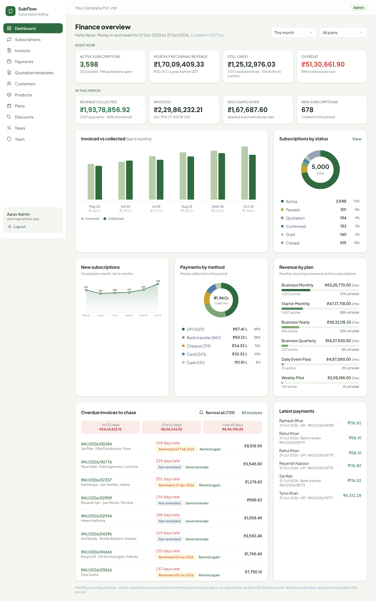
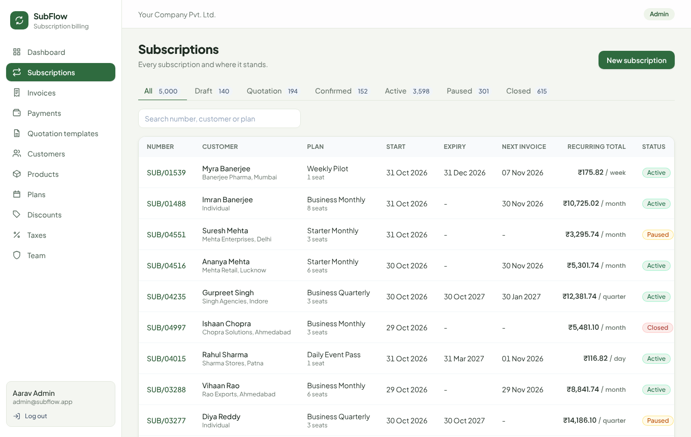
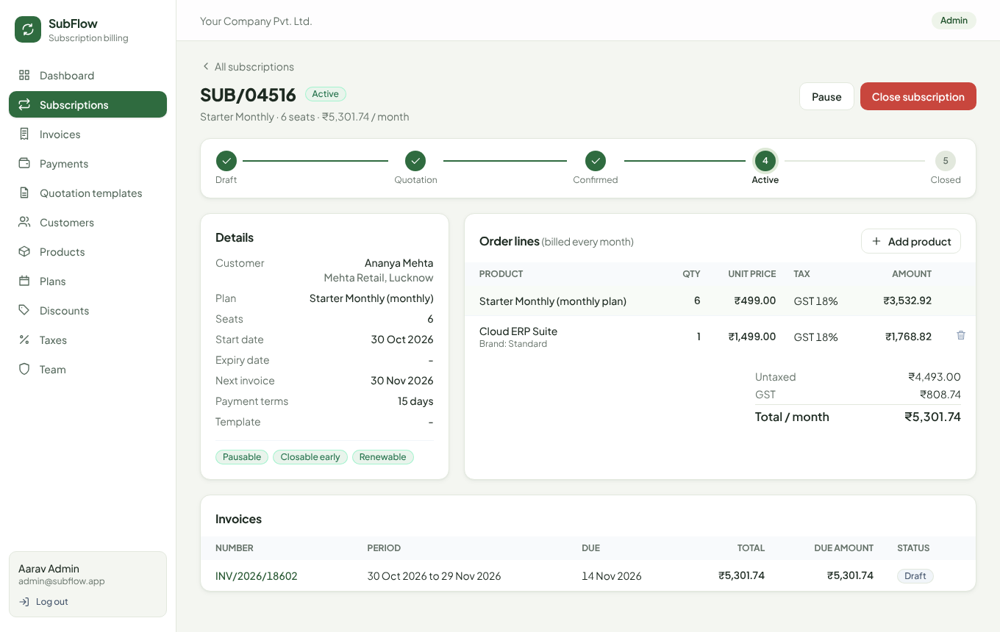
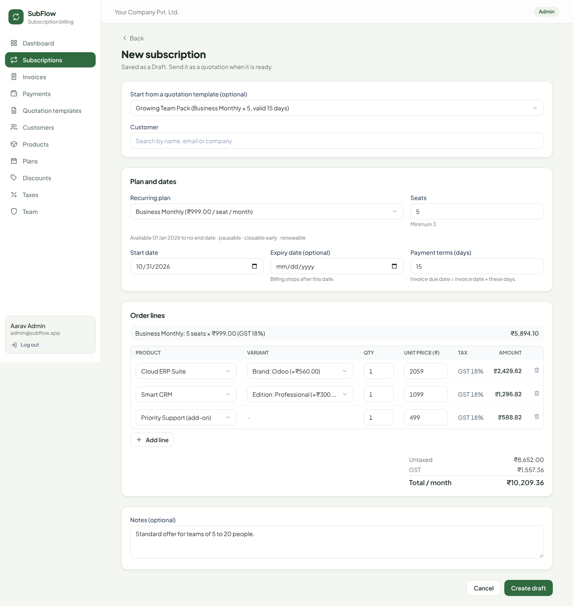
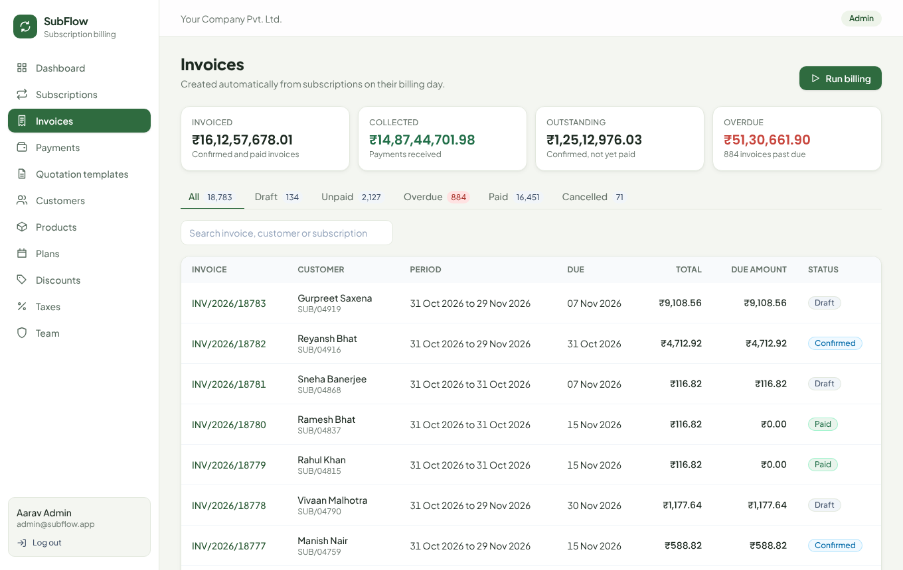
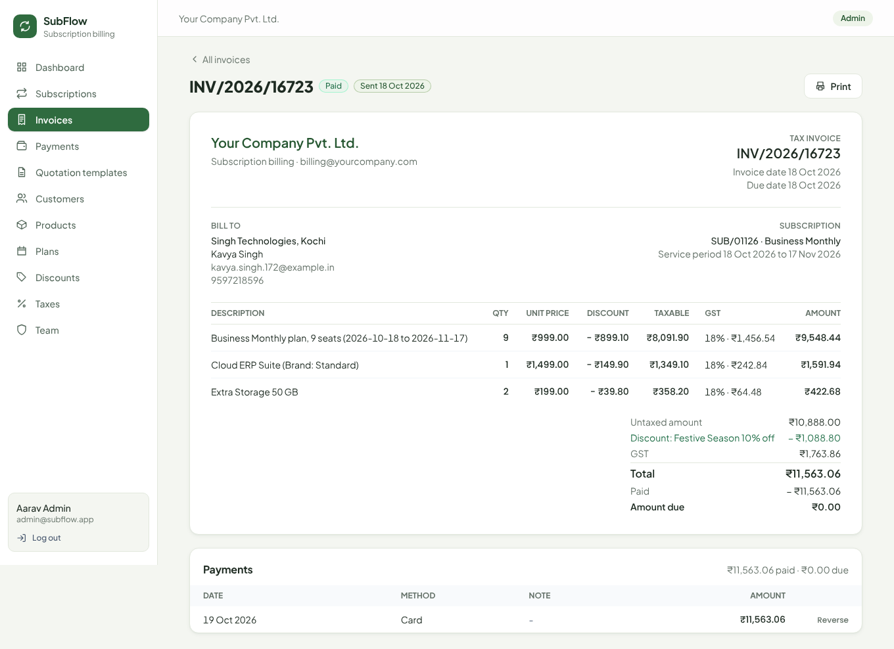
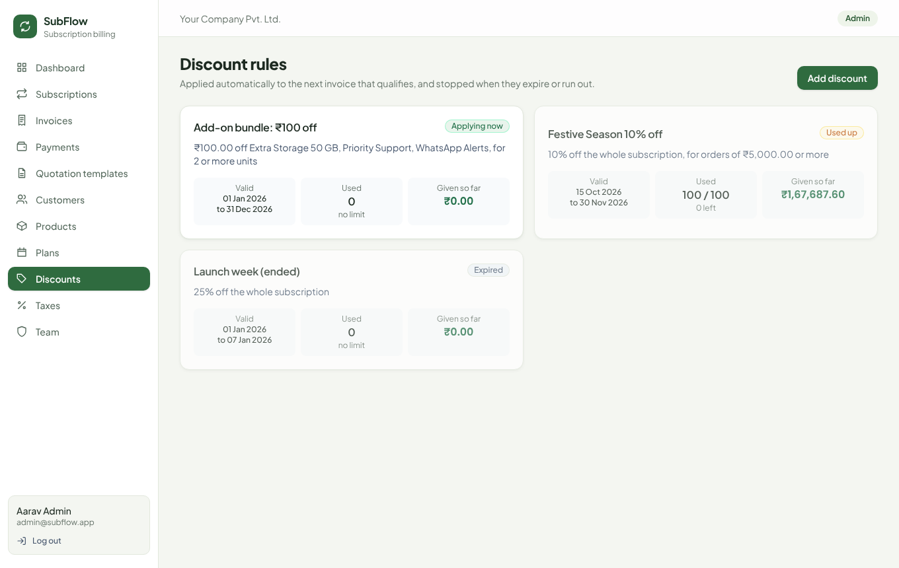
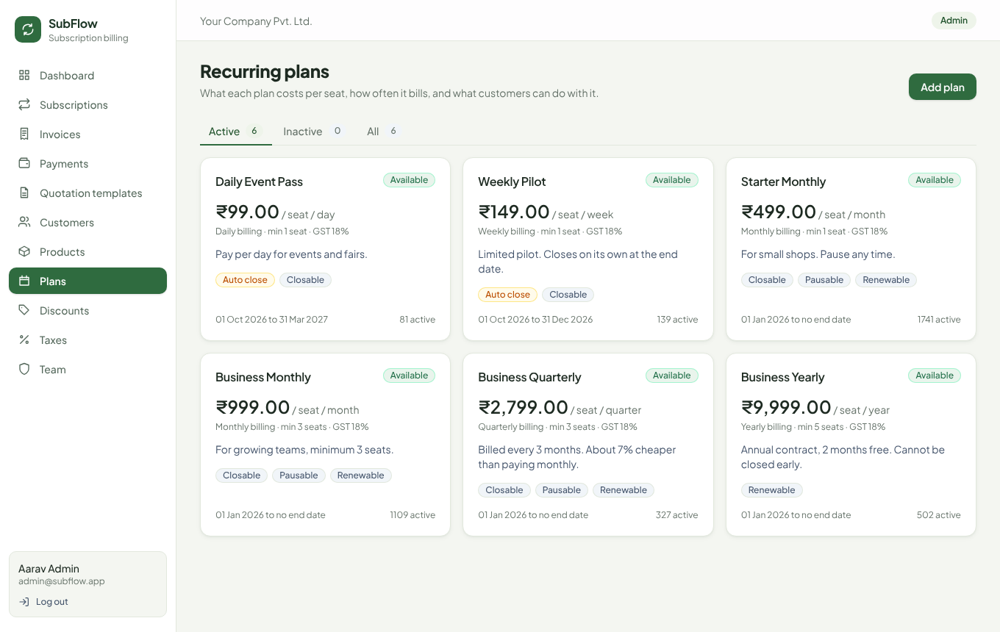
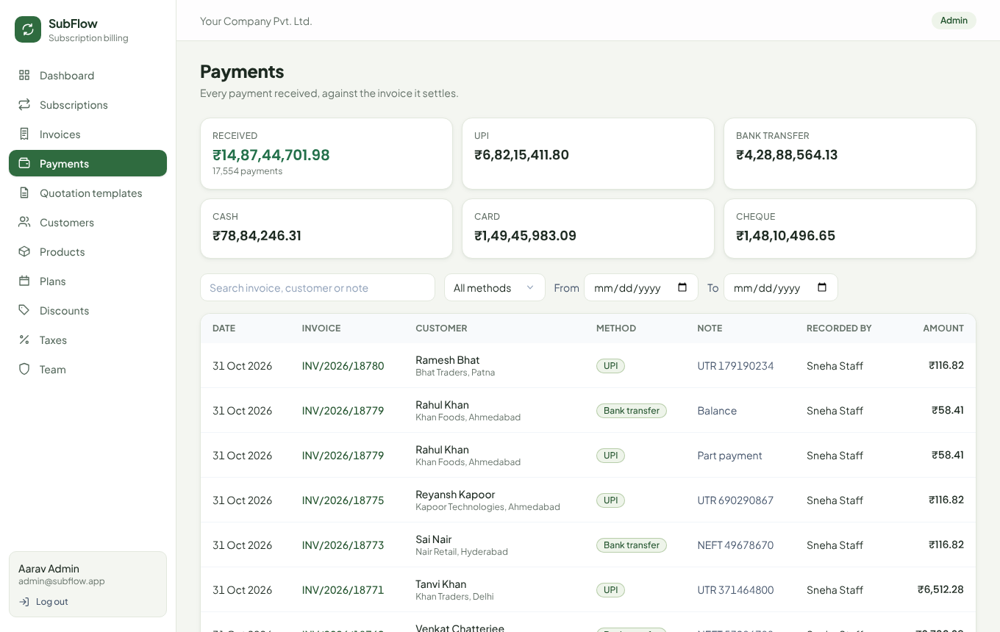
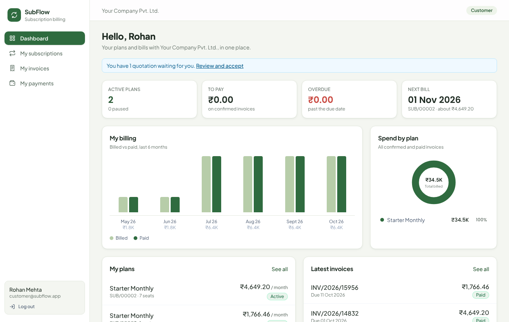

# SubFlow: Subscription Management System

**Odoo × FLUX Lucknow Hackathon '26 · Problem statement: Subscription Management System**

SubFlow is a **generic** subscription management and recurring billing system for any business that sells on subscription: products, recurring plans, quotations, subscriptions, automatic invoices, payments and revenue reports. It replaces spreadsheets, hand typed invoices and missed renewals with clear rules that the system follows every time. The business name is a setting (`COMPANY_NAME` in `server/.env`); the problem statement's example company, Brightloop Software, is just one possible user.

```
Product → Plan → Quotation → Subscription → Invoice → Payment → Reports
```

## Screenshots

| | |
|---|---|
|  **Finance dashboard**: active subscriptions, MRR, money owed, overdue aging, filters |  **Subscriptions**: status tabs with counts, search, recurring totals |
|  **Subscription**: Draft → Quotation → Confirmed → Active → Closed, plan rules, lines, invoices |  **Quotation from a template**: plan, seats and lines filled in |
|  **Invoices**: billing run, drafts to confirm, overdue tab |  **Tax invoice**: discount applied automatically, GST per line |
|  **Discount rules** (admin only): limits, dates, uses |  **Recurring plans**: period, minimum seats, dates, rules |
|  **Payments**: every method, part payments |  **Customer portal**: own plans, bills, quotations |

---

## The problem

The problem statement's example: a software company (Brightloop) sells software and services on monthly and yearly subscriptions. Today:
- Renewals are tracked in spreadsheets and get missed
- Invoices are typed by hand, so taxes and discounts are often wrong
- Payments are matched to invoices manually
- Nobody can see recurring revenue or overdue money at a glance
- Customers have to email the team for anything about their own subscription

## Who uses it

| Role | What they do |
|---|---|
| **Admin** | Controls the whole system. Sets up products, variants, recurring plans, tax rules and discount rules. Adds internal staff. |
| **Internal staff** | Day to day work: quotations, subscriptions, invoices, payments and follow ups. Limited access: cannot change taxes, discounts or staff. |
| **Customer** | Self service portal. Sees only their own subscriptions and invoices, and can manage them when the plan allows. |

Public signup always creates a customer. Staff accounts are created only by the admin.

---

## Features

**Status:** ✅ done · 🚧 in progress · ⬜ planned

| # | Module | Status |
|---|---|---|
| 1 | Project setup, full database schema, login, role based layout | ✅ |
| 2 | Signup with password rules, unique email, admin creates staff, customers, forgot password | ✅ |
| 3 | Products with variants, GST tax rules, recurring plans | ✅ |
| 4 | Quotation templates, subscriptions with order lines and status flow | ✅ |
| 5 | Automatic invoice generation, tax calculation, no double billing, confirm / cancel / send / print | ✅ |
| 6 | Payments (part payments, all methods), paid / outstanding / overdue tracking, payment reminders | ✅ |
| 7 | Discount rules (admin only) applied automatically to the next invoice, with usage limits and expiry | ✅ |
| 8 | Finance dashboard (active subscriptions, MRR, revenue, owed, overdue aging, top plans) with date and plan filters, plus a customer dashboard | ✅ |
| 9 | Customer portal: dashboard, accept quotation, pause, resume, close, renew, add-ons, invoices, payments | ✅ |
| 10 | Demo data (5,000 subscriptions, a year of history) and speed proof | ✅ |

### Business rules the system enforces
- **Password:** more than 8 characters, with one uppercase, one lowercase and one special character. Email must be unique.
- **Subscription flow:** Draft → Quotation → Confirmed → Active → Closed (plus Paused when the plan allows). Steps cannot be skipped.
- **Plan rules apply to everyone:** pause only if the plan is pausable, close before expiry only if closable, renew (adds one billing period to the expiry date) only if renewable.
- **Quotations expire:** a quotation can't be accepted after its validity date (template validity, default 30 days).
- **Invoice flow:** Draft → Confirmed → Paid, with Cancel allowed before payment.
- **No double billing, no skipped billing:** each subscription tracks its next invoice date; a unique index allows only one live invoice per subscription per billing period; the billing run catches up missed periods one by one; cancelling the latest invoice puts its period back in the queue.
- **Automatic billing:** runs at start-up and every hour (safe to repeat), plus a "Run billing" button for billing day. New invoices are drafts for the team to confirm.
- **Payments:** recorded against a confirmed invoice with method, amount, date and note; part payments allowed, overpayment blocked (row lock, safe even when two people record at once); the invoice turns Paid automatically. Only the admin can reverse a payment.
- **Overdue:** a confirmed invoice past its due date with money still due; the team can send a payment reminder.
- **Taxes** come from admin defined GST rules, never typed by hand.
- **Discounts** (fixed or percentage, minimum purchase or quantity, date range, usage limit, whole subscription or specific products) apply automatically to the next invoice and stop on their own when expired or used up. If several qualify, the customer gets the single best one; it is taken before GST and counts one use per invoice (a cancelled invoice gives the use back).
- **Speed:** every list is paginated and backed by database indexes, so pages load in under 2 seconds with thousands of records.
- **Plans are priced per seat:** plan price × seats (at least the plan's minimum quantity), with product and add-on lines on top.
- **Currency:** Indian Rupees (₹) with Indian number format (₹1,25,000.00).

---

## Tech stack

| Layer | Choice | Why |
|---|---|---|
| Frontend | React 18 + Vite + Tailwind CSS v4 | Fast to build, responsive, works on mobile |
| Backend | Node.js + Express 5 | Our own REST APIs with role checks on every route |
| Database | PostgreSQL (plain SQL with `pg`) | Real constraints protect the money: unique billing periods, valid amounts, valid statuses |
| Auth | JWT + bcrypt | Secure password hashing and stateless sessions |
| Validation | zod | Every input is checked on the server, not only in the browser |

No external paid APIs. Everything runs locally, even without internet.

## Architecture

```
Browser (React)  Admin · Staff · Customer screens
      │  JSON over HTTP + JWT token
      ▼
Express API      role check middleware → route → business rules
      │          (billing, tax, discount and status logic)
      ▼
PostgreSQL       users, products, variants, taxes, plans, templates,
                 subscriptions, invoices, payments, discounts
```

---

## Run it locally (Mac)

Requirements: Node.js 20+, PostgreSQL 14+.

```bash
# one time setup
brew install postgresql@16 node
brew services start postgresql@16
createdb subflow
```

**Backend** (terminal 1)
```bash
cd server
npm install
cp .env.example .env        # then set DATABASE_URL to your local Postgres
npm run db:setup            # creates tables + small clean demo (wipes old data)
npm run db:demo             # optional: adds a year of history (5,000 subscriptions, ~19,500 invoices)
                            # or both at once: npm run db:fresh
npm run dev                 # API on http://localhost:4000
```

**Frontend** (terminal 2)
```bash
cd client
npm install
npm run dev                 # app on http://localhost:5173
```

On Windows or Linux, install Node and PostgreSQL from their websites, create the `subflow` database, and run the same commands.

## Demo accounts

| Role | Email | Password |
|---|---|---|
| Admin | admin@subflow.app | Admin@1234 |
| Internal staff | staff@subflow.app | Staff@1234 |
| Customer | customer@subflow.app | Customer@1234 |
| Any demo customer (after `db:demo`) | see Customers page | Demo@12345 |

The login page also has one click buttons for these accounts.

## Performance (the "under 2 seconds" requirement)

Measured with `npm run db:fresh` loaded: **626 customers, 5,000 subscriptions, 19,506 invoices, 18,226 payments**.
Worst of 3 runs per API call, on a laptop:

| Page / API | Time |
|---|---|
| Finance dashboard (this month / financial year / one plan) | 104 / 78 / 84 ms |
| Subscriptions list, status tab page 50, search | 53 / 29 / 53 ms |
| Invoices list, overdue tab, search across all invoices, last page | 45 / 38 / 162 ms |
| Payments list, filtered by method and date range | 33 / 15 ms |
| Subscription detail, invoice detail | 13 / 7 ms |
| Customers, products, plans, discounts | under 10 ms |
| Run billing with 5,000 subscriptions (nothing due) | 8 ms |

How: every list is paginated on the server; indexes on status, customer, dates and due dates; the dashboard is a few
aggregate SQL queries (no row-by-row work in JavaScript). The dashboard shows its own load time on screen.

Demo data integrity (checked by SQL): every invoice total equals its lines, every amount paid equals its payments,
no subscription period is invoiced twice, every active subscription is billed up to date, and every cancelled invoice
has a re-issued invoice for the same period.

## Design decisions (where the problem statement leaves room)

| Topic | Decision |
|---|---|
| Plan price | Price **per seat per billing period**; seats must meet the plan's minimum quantity. Product and add-on lines bill on top at their sales price (+ variant extra) each period. |
| Variants | Unit price = product sales price + variant extra price (Brand: Odoo adds ₹560). |
| Taxes | Each product and plan links to one GST rule; tax is added on top, per line, rounded to the paisa. |
| Discounts | If several rules qualify, the customer gets the **single best** one; it is taken **before GST**; one use per invoice; a cancelled invoice gives the use back. |
| Billing | New invoices are **drafts** the team confirms (the PDF's Draft → Confirmed → Paid). Monthly periods keep the start day (31 Jan → 28 Feb → 31 Mar). No proration for a period cut short by the expiry date. |
| Cancelling | Only the **latest** invoice of a subscription can be cancelled; its period goes back in the queue and is billed again, so no period is ever skipped. Paid invoices cannot be cancelled. |
| Expiry | Billing stops after the expiry date. Plans that "close on their own" close automatically; others wait for renewal. Renewing adds one billing period to the expiry date and billing restarts from today (the expired gap is not back-billed). |
| Plan rules | Pausable / closable early / renewable are enforced for everyone, including staff. A cancelled quotation can never be revived; only the team can reopen a closed subscription that had been running. |
| Customer portal | Customers accept quotations, pause, resume, close and renew when the plan allows, and switch add-ons on/off. They never see internal drafts or other customers' data (404). |
| Overdue | A confirmed invoice past its due date with money still due. Part payments allowed; overpayment blocked. |
| Email | Without SMTP settings the app runs in demo mode: emails are printed in the server log. The password reset link is shown on screen **for customer accounts only**; admin and staff links are only ever emailed. |

## Known limitations

- No online payment gateway: payments are recorded by the team (the problem statement asks for recording payments).
- Product prices are per billing period, not per plan (a yearly plan bills a product once a year at its sales price).
- No proration when a plan changes mid period; add-on changes apply from the next invoice.

---

## Project structure

```
subflow/
├── SPEC.md                  API contract, roles, status flows (team reference)
├── server/
│   ├── db/schema.sql        all tables, constraints and indexes
│   ├── db/setup.js          creates schema and demo data
│   └── src/
│       ├── index.js         Express app
│       ├── db.js            Postgres pool and transaction helper
│       ├── middleware/      login check, role check, error handler
│       ├── routes/          one file per module
│       └── utils/           validation, pagination, errors
└── client/
    └── src/
        ├── api/             API client with login token
        ├── context/         logged in user state
        ├── config/nav.js    sidebar menu per role
        ├── components/      layout and shared UI
        ├── pages/           one file per screen
        └── utils/           ₹ and date formatting
```

## API overview

All endpoints live under `/api` and return JSON. Full list with request and response shapes is in [SPEC.md](SPEC.md).

| Area | Endpoints |
|---|---|
| Auth | `POST /auth/signup`, `POST /auth/login`, `GET /auth/me`, `POST /auth/forgot-password`, `POST /auth/reset-password` |
| Catalog | `/products`, `/plans`, `/taxes`, `/discounts`, `/templates` |
| Sales | `/customers`, `/subscriptions`, `/subscriptions/:id/transition` |
| Billing | `/invoices`, `/invoices/run-billing`, `/invoices/for-subscription/:id`, `/payments` |
| Reports | `/reports/summary` (dashboard) |
| Discounts | `/discounts` |

---

## Team

See [TEAM.md](TEAM.md) for who owns which module. Demo walkthrough: [DEMO.md](DEMO.md).

| Member | Module ownership |
|---|---|
| Abhishek Jain | Billing engine, invoices, payments, finance dashboard |
| Radhika | Auth, roles, users and customers |
| Kshiteesh Pandey | Subscriptions, quotation templates, customer portal |
| Vikash Kumar | Catalog (products, variants, plans, taxes, discounts) |

Built for the Odoo × FLUX Lucknow Hackathon '26 hosted at PW Institute of Innovation.
